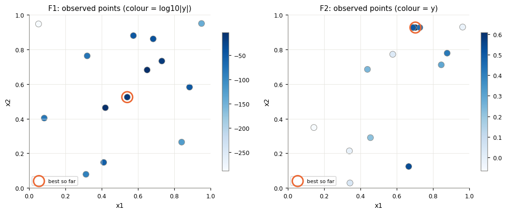
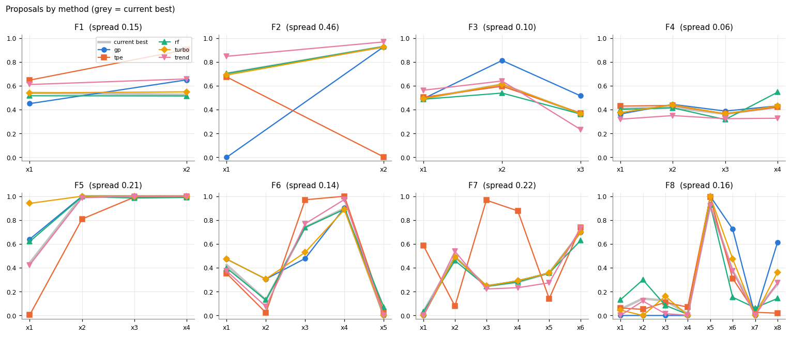
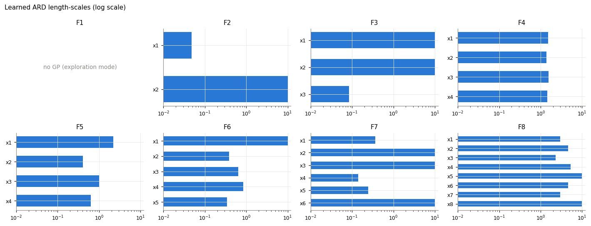
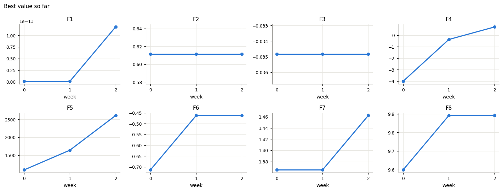
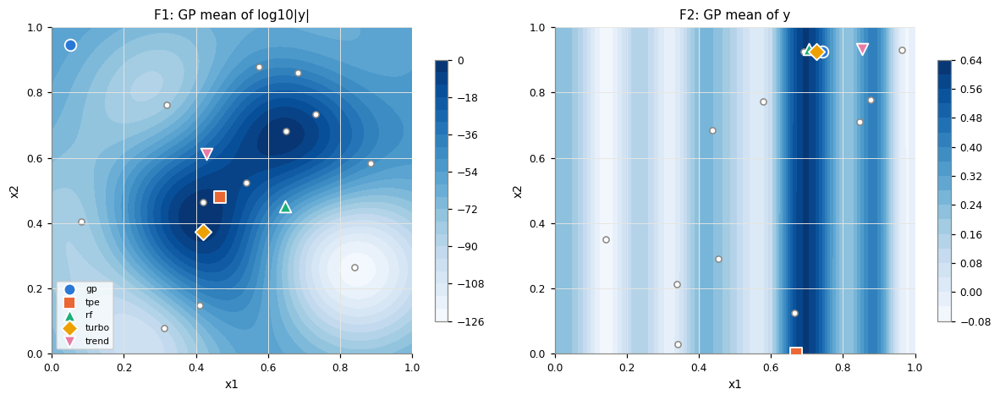
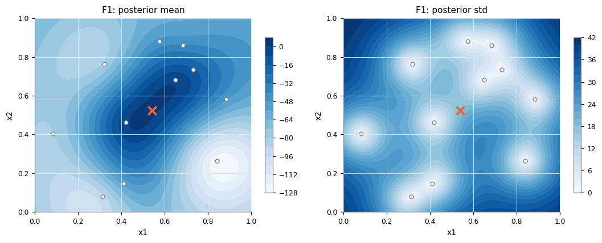

# Black-Box Optimisation Capstone: Finding the Maxima of Eight Unknown Functions

## NON-TECHNICAL EXPLANATION OF YOUR PROJECT

Imagine trying to find the best recipe, machine setting or drug dose when every test is slow and expensive, and you can't see how the process works inside. This project tackles eight such "black box" problems, ranging from locating a radiation source to tuning a machine-learning model. For each one I get a handful of past results and just one new test per week. Rather than guessing, I build a statistical "map" of each problem from the results so far. The map shows both where the best answer probably lies and where I am still uncertain. I then choose each week's test to balance improving on known good settings against exploring the unknown.

## DATA

The data was provided by the capstone programme as part of a Bayesian-optimisation-style challenge. It is synthetic: each function is an unknown mathematical function written by the course team to imitate a real-world problem. No external datasets were used.

| Function | Inputs | Starting points | Real-world analogy (from the brief)                                             |
| -------- | ------ | --------------- | ------------------------------------------------------------------------------- |
| 1        | 2      | 10              | Detecting contamination (e.g. radiation) sources: signal only near a source     |
| 2        | 2      | 10              | Noisy log-likelihood of a mystery ML model, with local optima                   |
| 3        | 3      | 15              | Drug discovery: minimise adverse reactions (outputs negated)                    |
| 4        | 4      | 30              | Warehouse product placement: ML approximation of an expensive calculation       |
| 5        | 4      | 20              | Chemical process yield (typically one peak)                                     |
| 6        | 5      | 20              | Cake recipe: negative score from flavour, consistency, calories, waste and cost |
| 7        | 6      | 30              | Tuning six ML hyperparameters                                                   |
| 8        | 8      | 40              | Tuning eight ML hyperparameters (e.g. learning rate, dropout, optimiser type)   |

- **Format:** for each function, `initial_inputs.npy` (an n × d array, with every input in [0, 1]) and `initial_outputs.npy` (n values). Every task is a **maximisation**.
- **Growth:** each week I submit one query per function through the portal, formatted as six-decimal values joined by hyphens (e.g. `0.419675-0.463269`), and receive one new output. All submissions and results are recorded in the `HISTORY` cell of the notebook.
- **Notable properties of the starting data:**
  - Function 1 is almost zero everywhere (1e-124 to 1e-15).
  - Function 5 spans four orders of magnitude (0.1 to 1089).
  - Function 8 is close to linear (a straight-line fit explains 90% of the variance).

_Data for Functions 1 and 2 after Week 2. Colour shows the output: log10|y| for F1, y for F2. The orange circle marks the best point._

## MODEL

**Primary model: a Gaussian Process (GP) surrogate with Bayesian optimisation.**

A GP predicts the output at any input **together with an uncertainty**. With only 10–40 expensive observations, that uncertainty is what makes principled exploration possible, so a GP was the natural choice. My configuration:

- **ARD kernel** (a separate length-scale for each input), so the learned length-scales show which inputs matter. Weeks 1–2 used Matern 5/2 everywhere. **From Week 3 the kernel is chosen per function** from Matern 3/2, Matern 5/2 and RBF, by log marginal likelihood. In Week 3 the data chose RBF for Functions 2, 3, 5, 6 and 7, and Matern 5/2 for Functions 4 and 8.
- **A white-noise term**, for noisy functions such as Function 2 and for numerical stability.
- **Normalised outputs**, plus two transforms: **log(y)** for Function 5 because of its huge range, and from Week 2 **log10|y|** for Function 1, whose readings are too extreme (1e-124 to 0.006) to model directly.
- **Leave-one-out validation** (Spearman correlation) to measure how far each function's GP can be trusted.

An **acquisition function** turns the GP's prediction and uncertainty into a score for each candidate point: Expected Improvement (EI) or Upper Confidence Bound (UCB). The best-scoring point is found in three steps:

1. **Score about 60,000 candidates**, drawn globally and around the best known points. Points that fall outside [0, 1] are reflected back inside.
2. **Refine the 10 best** with a gradient optimiser (multi-start L-BFGS-B).
3. **Anchor irrelevant inputs:** any input the model considers irrelevant is reset to its value at the best known point.

Steps 2 and 3, and the reflection in step 1, were added in Week 2 (see Results).

**Four alternative strategies are run as cross-checks every week**, because one model can be misled by so little data:

| Method                                 | Idea                                                                                                                                                | Why include it                                                       |
| -------------------------------------- | --------------------------------------------------------------------------------------------------------------------------------------------------- | -------------------------------------------------------------------- |
| TPE (Tree-structured Parzen Estimator) | Models the density of "good" and "bad" inputs                                                                                                       | Standard in hyperparameter-tuning tools, robust in higher dimensions |
| Random Forest (the idea behind SMAC)   | A tree ensemble, with the spread between trees as the uncertainty                                                                                   | Handles thresholds and discrete-like inputs                          |
| TuRBO-style trust region               | GP search in a box that grows after successes and shrinks after failures. From Week 3, inputs the model considers irrelevant stay at the best value | Built for high dimensions with small budgets                         |
| Linear trend-following                 | A step up the fitted gradient                                                                                                                       | A simple, transparent baseline                                       |

When the methods agree, I exploit confidently. When they disagree, I stay closer to what has worked.

_Where each of the five methods proposes to query in Week 3. Overlapping lines mean the methods agree._

## HYPERPARAMETER OPTIMISATION

The project involves two layers of hyperparameters.

**1. Surrogate-model hyperparameters, fitted automatically.** The GP's amplitude, one length-scale per input and its noise level are all fitted by **maximising the marginal likelihood**, using L-BFGS with 15 random restarts to avoid poor local fits. From Week 3 the kernel family is also a fitted choice: the one with the highest marginal likelihood wins. Length-scales are bounded to [0.02, 10] and noise to [1e-6, 0.1]. The fitted length-scales are useful in themselves: a short one marks an important input, and one at the upper bound marks an input the model considers irrelevant.

_Learned ARD length-scales after Week 2 (log scale). A shorter bar means a more important input. For Function 2 the model treats x2 as irrelevant, and for Function 3 it treats x1 and x2 as irrelevant._

**2. Optimisation-strategy hyperparameters, set per function and reviewed weekly.** These control the balance between exploration and exploitation. They are set by reasoning from each function's brief and data, not by automated tuning, because every evaluation costs a week.

| Setting              | Role                                             | Week 1                           | Week 2                            | Week 3                                                      |
| -------------------- | ------------------------------------------------ | -------------------------------- | --------------------------------- | ----------------------------------------------------------- |
| Kernel               | Smoothness assumption                            | Matern 5/2                       | Matern 5/2                        | Chosen per function (RBF or Matern 5/2)                     |
| Acquisition function | EI (balanced) or UCB (explicit exploration)      | EI for F3–F6, UCB for F2, F7, F8 | Same, plus EI for F1              | Same; F1 back to maximin                                    |
| κ (UCB)              | Exploration strength                             | 2                                | 1 for F2 and F7, 1.5 for F8       | 2 for F2 (explore again), 1 for F7 and F8                   |
| ξ (EI)               | Exploration strength                             | 0.01                             | 0.005 for F4 and F6               | 0.001 for F4                                                |
| Trust region         | Limits the search to ±`tr` around the best point | ±0.2 for F5                      | ±0.15 for F4 and F7, ±0.25 for F3 | ±0.1 for F4 and F7, ±0.15 for F3 and F6, ±0.2 for F5 and F8 |
| Output transform     | Makes wide-ranging outputs easier to model       | log(y) for F5                    | Added log10\|y\| for F1           | Same                                                        |
| Exploration mode     | Maximin space-filling while there is no signal   | F1                               | Off                               | F1 again                                                    |
| TuRBO box size L     | ×1.5 after an improvement, ×0.7 after a failure  | 0.4                              | 0.6 or 0.28                       | 0.8 to 0.2, per function                                    |

**Weekly adjustment rule:**

- Where a query improves on the best, I lower κ or ξ and shrink the search region (exploit).
- Where a function stalls for 2–3 weeks, I raise them (explore).
- To choose each final query, I follow the GP where it predicts well (LOO ≥ 0.7), take the consensus of the five methods where they agree, and use TuRBO where they disagree. I can override this with a written reason.

Functions 7 and 8 are themselves ML hyperparameter-tuning problems, so this project is also a small case study in **Bayesian hyperparameter optimisation**.

## RESULTS

_Status: Week 2 results received, Week 3 queries chosen. This section is updated each week._

### Best value per function so far

| Function | Starting best | After Week 1 | After Week 2 | Change so far          |
| -------- | ------------- | ------------ | ------------ | ---------------------- |
| 1        | 7.7e-16       | 7.7e-16      | 1.2e-13      | Still effectively zero |
| 2        | 0.611         | 0.611        | 0.611        | No gain                |
| 3        | -0.035        | -0.035       | -0.035       | No gain                |
| 4        | -4.03         | -0.379       | **0.712**    | From -4.03 to +0.71    |
| 5        | 1089          | 1639         | **2605**     | 2.4 times the start    |
| 6        | -0.714        | **-0.462**   | -0.462       | 35% closer to zero     |
| 7        | 1.365         | 1.365        | **1.462**    | +7%                    |
| 8        | 9.60          | **9.891**    | 9.891        | +3%                    |

_Best value found so far for each function. Week 0 is the best of the starting data._

### Results against predictions

| Function | Week 1 result | z    | Week 2 result | z        |
| -------- | ------------- | ---- | ------------- | -------- |
| 1        | -0.0061       | –    | 1.2e-13       | -0.8     |
| 2        | -0.026        | -1.8 | 0.593         | -0.3     |
| 3        | -0.138        | -1.0 | -0.048        | 0.0      |
| 4        | **-0.379**    | +2.0 | **0.712**     | **+5.0** |
| 5        | **1639**      | -0.3 | **2605**      | +0.3     |
| 6        | **-0.462**    | -0.8 | -0.517        | -0.7     |
| 7        | 1.219         | -0.4 | **1.462**     | +1.5     |
| 8        | **9.891**     | -1.3 | 9.859         | -1.0     |

The z-score is (result − prediction) ÷ predicted standard deviation, in the model's own scale. Bold marks a new best. **Four of eight queries improved the best in each week.** Across both weeks the mean z is +0.02, so on average the model's predictions are neither too high nor too low.

### What I have learned

- **Exploiting a clear trend with a reliable model works.** Functions 4 and 5 improved in both weeks. Function 4 went from -4.03 to +0.71.
- **Small steps beat big ones.** In Week 2, small steps gave new bests for Functions 4, 5 and 7 (0.04–0.23 from the best). Bigger, multi-input steps for Functions 6 and 8 (0.20 and 0.48) narrowly missed.
- **Exploratory queries that miss still rule things out.** Function 2 has no second peak at the high-x1 edge. Function 3's optimum is not at x3 = 0. Function 1 has no strong source between its two negative readings.
- **Functions 2 and 3 look flat near their best.** A near-repeat of Function 2's best gave 0.593 against 0.611, so noise of about ±0.02 may now matter as much as position.
- **One model is not right for every function.** Function 4's Week 2 result was five standard deviations _above_ prediction, showing the model had the peak's shape wrong. Fitting three kernels showed the best one differs by function.

### Pipeline changes so far

| After  | Change                                                | Why                                                                               |
| ------ | ----------------------------------------------------- | --------------------------------------------------------------------------------- |
| Week 1 | Reflect candidates instead of clipping them           | Clipping biased queries towards exactly 0 or 1                                    |
| Week 1 | Multi-start L-BFGS-B refinement of the acquisition    | Random candidates alone were imprecise in 6–8 dimensions                          |
| Week 1 | Anchor irrelevant inputs to the best known point      | They were otherwise set arbitrarily                                               |
| Week 1 | Store and review predictions                          | To track how well calibrated the model is                                         |
| Week 2 | Choose the kernel per function by marginal likelihood | Function 4's z = +5. For Function 5, the reliability score rose from 0.57 to 0.81 |
| Week 2 | TuRBO holds irrelevant inputs at the best value       | It proposed far corners (the Function 3 override in Week 2)                       |

### Queries submitted

| Function | Week 2 query (method)                                                          | Week 3 query (method)                                                          |
| -------- | ------------------------------------------------------------------------------ | ------------------------------------------------------------------------------ |
| 1        | `0.540351-0.524565` (consensus)                                                | `0.051118-0.947227` (maximin)                                                  |
| 2        | `0.690829-0.926564` (TuRBO)                                                    | `0.727137-0.926564` (TuRBO)                                                    |
| 3        | `0.492581-0.861593-0.399583` (GP, override)                                    | `0.492581-0.611593-0.362899` (TuRBO)                                           |
| 4        | `0.407459-0.418058-0.364200-0.420348` (GP)                                     | `0.375309-0.431898-0.364200-0.431114` (GP)                                     |
| 5        | `0.039972-0.830719-0.986193-0.995123` (consensus)                              | `0.239972-0.999999-0.986193-0.999999` (GP)                                     |
| 6        | `0.472525-0.247156-0.628220-0.999999-0.000000` (GP)                            | `0.423548-0.096277-0.881854-0.999999-0.000000` (consensus)                     |
| 7        | `0.000000-0.491672-0.247422-0.250718-0.394579-0.698452` (consensus)            | `0.033992-0.491672-0.247422-0.279911-0.355814-0.698452` (TuRBO)                |
| 8        | `0.052325-0.000000-0.124313-0.014745-0.999999-0.641250-0.299616-0.000000` (GP) | `0.180785-0.000000-0.124313-0.000000-0.999999-0.234896-0.223487-0.462463` (GP) |

In Week 3 I accepted the recommended method for all eight functions. Two queries are deliberate tests:

- **Function 3** is a near-repeat of its best point, to check whether -0.035 was real or lucky noise.
- **Function 1** returns to space-filling, to look for a positive source elsewhere.

_Week 3 proposals from all five methods on the 2D functions. For Function 1, the GP pipeline's maximin point is in the top-left gap. The other methods, modelling the size of the reading, still point to the centre, which Week 2 showed to be empty._

_Week 2: Function 1 modelled as log10|y|. The query (orange ×) targeted the strongest predicted signal between the two negative readings. It returned +1.2e-13, showing there is no strong source there._

### Repository contents

| File                          | Description                                                                                                                                   |
| ----------------------------- | --------------------------------------------------------------------------------------------------------------------------------------------- |
| `capstone_bbo.ipynb`          | Full weekly pipeline: data, exploratory analysis, GP, acquisition, five-method comparison, final selection, progress tracking and reflections |
| `function_1/` … `function_8/` | Initial `.npy` data                                                                                                                           |
| `week_<N>_queries.csv`        | Queries chosen each week, with the method used and the model's prediction                                                                     |
| `images/`                     | Figures used in this README                                                                                                                   |

**To run it:** `pip install numpy pandas scipy scikit-learn matplotlib jupyter`, then open the notebook next to the `function_*` folders and run all cells.
