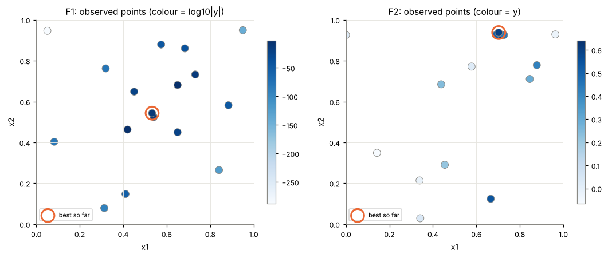
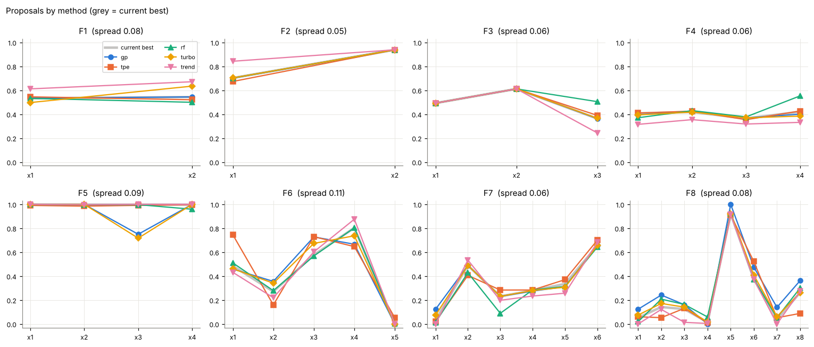
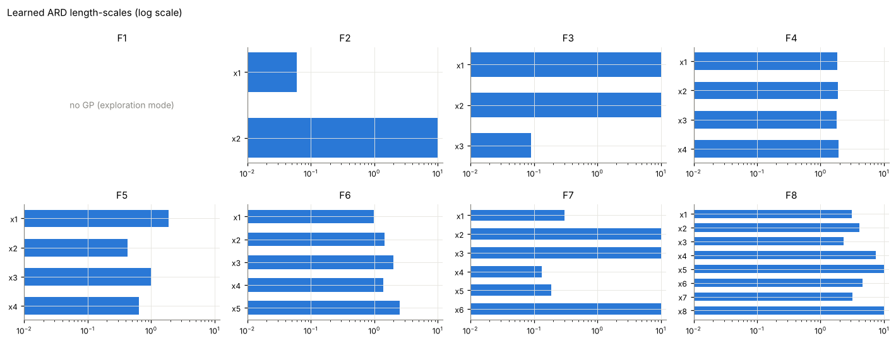
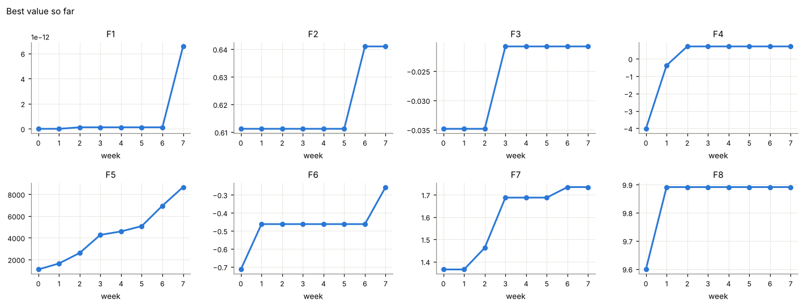
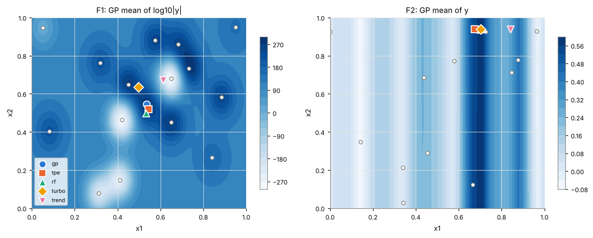

# Black-Box Optimisation Capstone: Finding the Maxima of Eight Unknown Functions

## NON-TECHNICAL EXPLANATION OF YOUR PROJECT

Imagine trying to find the best recipe, machine setting or drug dose when every test is slow and expensive, and you can't see how the process works inside. This project tackles eight such "black box" problems, ranging from locating a radiation source to tuning a machine-learning model. For each one I get a handful of past results and just one new test per week. Rather than guessing, I build a statistical "map" of each problem from the results so far. The map shows both where the best answer probably lies and where I am still uncertain. I then choose each week's test to balance improving on known good settings against exploring the unknown.

## DATA

The data was provided by the capstone programme as part of a Bayesian-optimisation-style challenge. It is synthetic: each function is an unknown mathematical function written by the course team to imitate a real-world problem. No external datasets were used.

| Function | Inputs | Starting points | Real-world analogy (from the brief)                                             |
| -------- | ------ | --------------- | ------------------------------------------------------------------------------- |
| 1        | 2      | 10              | Detecting contamination (e.g. radiation) sources: signal only near a source     |
| 2        | 2      | 10              | Noisy log-likelihood of a mystery ML model, with local optima                   |
| 3        | 3      | 15              | Drug discovery: minimise adverse reactions (outputs negated)                    |
| 4        | 4      | 30              | Warehouse product placement: ML approximation of an expensive calculation       |
| 5        | 4      | 20              | Chemical process yield (typically one peak)                                     |
| 6        | 5      | 20              | Cake recipe: negative score from flavour, consistency, calories, waste and cost |
| 7        | 6      | 30              | Tuning six ML hyperparameters                                                   |
| 8        | 8      | 40              | Tuning eight ML hyperparameters (e.g. learning rate, dropout, optimiser type)   |

- **Format:** for each function, `initial_inputs.npy` (an n × d array, with every input in [0, 1]) and `initial_outputs.npy` (n values). Every task is a **maximisation**.
- **Growth:** each week I submit one query per function through the portal, formatted as six-decimal values joined by hyphens (e.g. `0.419675-0.463269`), and receive one new output. All submissions and results are recorded in the `HISTORY` cell of the notebook.
- **Notable properties of the starting data:**
  - Function 1 is almost zero everywhere (1e-124 to 1e-15).
  - Function 5 spans four orders of magnitude (0.1 to 1089).
  - Function 8 is close to linear (a straight-line fit explains 90% of the variance).

_Data for Functions 1 and 2 after Week 7. Colour shows the output: log10|y| for F1, y for F2. The orange circle marks the best point._

## MODEL

**Primary model: a Gaussian Process (GP) surrogate with Bayesian optimisation.**

A GP predicts the output at any input **together with an uncertainty**. With only 10–40 expensive observations, that uncertainty is what makes principled exploration possible, so a GP was the natural choice. My configuration:

- **ARD kernel** (a separate length-scale for each input), so the learned length-scales show which inputs matter. Weeks 1–2 used Matern 5/2 everywhere. **From Week 3 the kernel is chosen per function** from Matern 3/2, Matern 5/2 and RBF, by log marginal likelihood. In Week 3 the data chose RBF for Functions 2, 3, 5, 6 and 7, and Matern 5/2 for Functions 4 and 8.
- **A minimum noise level (from Week 4).** The noise term may not fall below 0.03 (in normalised units). Without this floor the GP passed almost exactly through every point and was overconfident: three predictions missed by 4–5 standard deviations. A backtest on Weeks 2–3 cut the typical miss from 3.0 to 1.3 standard deviations, and in Weeks 4 and 5 the typical miss was 1.0 and 0.7. Function 4, whose outputs span -32 to +0.7, uses a lower floor (0.001) from Week 5, so that its peak is not blurred. **From Week 8 the floor is set per function by the data:** a repeat of Function 4 matched to the last digit, and refitting with a floor of 1e-6 raised the log marginal likelihood by 17 (Function 8), 8 (Function 5) and 6.5 (Function 7). So Functions 4, 5, 7 and 8 are treated as noise-free (floor 1e-6 to 1e-4), while Functions 2, 3 and 6 keep 0.03.
- **A noise-aware incumbent (from Week 5).** "Best point" means the observed point with the highest _model estimate_, not the single highest reading. Week 4 re-tests showed repeat readings at almost the same spot differ by as much as the gains being chased, so the highest reading is often a lucky draw (the winner's curse).
- **A raw incumbent for noise-free functions (from Week 8).** For Function 4, whose repeat was identical, the best reading is the truth, so it centres the trust region.
- **Held inputs (from Week 7).** A length-scale at its cap means the GP has _no evidence_ an input matters, which is not evidence that it doesn't. For Function 3 the optimiser set such an input (x2) to 1, and the result was the worst in the region. Chosen inputs can now be held at values with good evidence, for every method's proposal.
- **A white-noise term**, for noisy functions such as Function 2 and for numerical stability.
- **Normalised outputs**, plus transforms: **log(y)** for Function 5 because of its huge range. For Function 1, whose readings range from 1e-288 to 0.006, I used **log10|y|** in Week 2 and a sign-aware version from Week 4.
- **Leave-one-out validation** (Spearman correlation) to measure how far each function's GP can be trusted.

An **acquisition function** turns the GP's prediction and uncertainty into a score for each candidate point: Expected Improvement (EI) or Upper Confidence Bound (UCB). The best-scoring point is found in three steps:

1. **Score about 60,000 candidates**, drawn globally and around the best known points. Points that fall outside [0, 1] are reflected back inside.
2. **Refine the 10 best** with a gradient optimiser (multi-start L-BFGS-B).
3. **Anchor irrelevant inputs:** any input the model considers irrelevant is reset to its value at the best known point.

Steps 2 and 3, and the reflection in step 1, were added in Week 2 (see Results).

**Four alternative strategies are run as cross-checks every week**, because one model can be misled by so little data:

| Method                                 | Idea                                                                                                                                                | Why include it                                                       |
| -------------------------------------- | --------------------------------------------------------------------------------------------------------------------------------------------------- | -------------------------------------------------------------------- |
| TPE (Tree-structured Parzen Estimator) | Models the density of "good" and "bad" inputs                                                                                                       | Standard in hyperparameter-tuning tools, robust in higher dimensions |
| Random Forest (the idea behind SMAC)   | A tree ensemble, with the spread between trees as the uncertainty                                                                                   | Handles thresholds and discrete-like inputs                          |
| TuRBO-style trust region               | GP search in a box that grows after successes and shrinks after failures. From Week 3, inputs the model considers irrelevant stay at the best value | Built for high dimensions with small budgets                         |
| Linear trend-following                 | A step up the fitted gradient                                                                                                                       | A simple, transparent baseline                                       |

When the methods agree, I exploit confidently. When they disagree, I stay closer to what has worked.

_Where each of the five methods proposes to query in Week 8. Overlapping lines mean the methods agree._

## HYPERPARAMETER OPTIMISATION

The project involves two layers of hyperparameters.

**1. Surrogate-model hyperparameters, fitted automatically.** The GP's amplitude, one length-scale per input and its noise level are all fitted by **maximising the marginal likelihood**, using L-BFGS with 15 random restarts to avoid poor local fits. From Week 3 the kernel family is also a fitted choice: the one with the highest marginal likelihood wins. From Week 4 the noise level has a lower bound of 0.03, chosen by backtesting calibration on Weeks 2–3. Length-scales are bounded to [0.02, 10] and noise to [floor, 0.5], where the floor is set per function (see the settings table). The fitted length-scales are useful in themselves: a short one marks an important input, and one at the upper bound marks an input the model considers irrelevant.

_Learned ARD length-scales after Week 7 (log scale). A shorter bar means a more important input. For Function 2 the model treats x2 as irrelevant, and for Function 3 it treats x1 and x2 as irrelevant._

**2. Optimisation-strategy hyperparameters, set per function and reviewed weekly.** These control the balance between exploration and exploitation. They are set by reasoning from each function's brief and data, not by automated tuning, because every evaluation costs a week.

| Setting | Role | Week 1 | Week 2 | Week 3 | Week 4 | Week 5 | Week 6 | Week 7 | Week 8 |
|---|---|---|---|---|---|---|---| --- | --- |
| Kernel | Smoothness assumption | Matern 5/2 | Matern 5/2 | Per function | Per function | Per function | Per function | Per function | Per function |
| Noise floor | Minimum noise level | 1e-6 | 1e-6 | 1e-6 | 0.03 | 0.03 (F4: 0.001) | 0.03 (F4: 0.001) | 0.03 (F4: 0.001) | 0.03 (F2, F3, F6); 1e-4 (F5, F7, F8); 1e-6 (F4) |
| Incumbent | What counts as "best" | Highest reading | Highest reading | Highest reading | Highest reading | Highest model estimate | Highest model estimate | Model estimate (TR centre); best reading (EI bar) | Model estimate; best reading for F4 |
| κ (UCB) | Exploration strength | 2 | 1–1.5 | 1–2 | 0.5–1 | 3 for F2, 1.5 for F8, 1 for F7 | 1 for F7 and F8 | – (all EI) | – (all EI) |
| ξ (EI) | Exploration strength | 0.01 | 0.005 for F4, F6 | 0.001 for F4 | 0.001–0.005 | 0.05 for F4, 0.01 otherwise | 0.005 for F6, 0.01 otherwise | 0 everywhere, vs best reading | 0 everywhere, vs best reading |
| Trust region | Limits the search to ±`tr` around the best point | F5 only | F3, F4, F7 | All except F1, F2 | ±0.05–0.2 | ±0.1–0.25; none for F2 | ±0.05 (F4) to ±0.25 (F5) | ±0.05 (F2) to ±0.25 (F5); F4 re-measures | ±0.02 (F4) to ±0.25 (F5); ±0.15 for F6 |
| Output transform | Makes wide-ranging outputs easier to model | log(y) for F5 | + log10\|y\| for F1 | Same | F1: sign-aware log | Same | Same | Same | Same |
| Exploration mode | Maximin space-filling | F1 | Off | F1 (whole space) | F1 (upper right) | F1 (around its best reading) | F1 (around its best reading) | Off; F1 log-quadratic fit | Off; F1 log-quadratic fit |
| Repeats | Re-measuring a known point | – | – | – | Deliberate re-tests (F2, F3) | Overridden by hand | Blocked by the no-repeat rule | Allowed (scored on best reading) | Allowed; EI avoids them for noise-free functions |
| Held inputs | Inputs fixed at well-evidenced values | – | – | – | – | – | – | F2: x2; F3: x1, x2 | F2: x2; F3: x1, x2 |

**Weekly adjustment rule:**

- Where a query improves on the best, I lower κ or ξ and shrink the search region (exploit).
- Where a function stalls for 2–3 weeks, I raise them (explore).
- To choose each final query, I follow the GP where it predicts well (LOO ≥ 0.7), take the consensus of the five methods where they agree, and use TuRBO where they disagree. I can override this with a written reason.
- **No-repeat rule (from Week 6):** if the chosen point is within 0.01 of a point already measured, I take the non-repeating proposal with the highest model estimate instead. Noise is already measured, so a repeat only spends a query.
- **Held inputs (from Week 7):** an input the GP calls irrelevant is held at its best-evidenced value when moving it has hurt before.
- **Noise by evidence (from Week 8):** each function's noise floor follows the likelihood test above, not one shared value.
- **Final weeks (from Week 7):** I am scored on my best observed reading, so every function uses EI with ξ = 0 against its best raw reading (the expected gain in score), and repeats are allowed.

Functions 7 and 8 are themselves ML hyperparameter-tuning problems, so this project is also a small case study in **Bayesian hyperparameter optimisation**.

## RESULTS

_Status: Week 7 results received, Week 8 queries chosen (three weeks remain). This section is updated each week._

### Best value per function so far

| Function | Start | W1 | W2 | W3 | W4 | W5 | W6 | W7 | Model's estimate | Change so far |
|---|---|---|---|---|---|---|---|---|---|---|
| 1 | 7.7e-16 | 7.7e-16 | 1.2e-13 | 1.2e-13 | 1.2e-13 | 1.2e-13 | 1.2e-13 | **6.6e-12** | – | 8,500 times the start (still tiny in absolute terms) |
| 2 | 0.611 | 0.611 | 0.611 | 0.611 | 0.611 | 0.611 | **0.641** | 0.641 | 0.602 | +5% (re-measure gave 0.602) |
| 3 | -0.035 | -0.035 | -0.035 | -0.021 | -0.021 | -0.021 | -0.021 | -0.021 | -0.034 | Within noise of the start |
| 4 | -4.03 | -0.379 | 0.712 | 0.712 | 0.712 | 0.712 | 0.712 | 0.712 | 0.712 | From -4.03 to 0.712 (reproduced exactly) |
| 5 | 1089 | 1639 | 2605 | 4269 | 4585 | 5074 | **6947** | **8662** | 8518 | 8.0 times the start |
| 6 | -0.714 | -0.462 | -0.462 | -0.462 | -0.462 | -0.462 | -0.462 | **-0.257** | -0.433 | 64% closer to zero |
| 7 | 1.365 | 1.365 | 1.462 | 1.687 | 1.687 | 1.687 | **1.734** | 1.734 | 1.731 | +27% |
| 8 | 9.60 | 9.891 | 9.891 | 9.891 | 9.891 | 9.891 | 9.891 | 9.891 | 9.887 | +3% |

The **model's estimate** averages nearby readings, so it is a fairer measure of where each function really stands than the single best reading. For Functions 4, 5, 7 and 8, which are noise-free, it is within 2% of the best reading, so those readings are real. The gap is 6% for Function 2, 41% for Function 6 and 63% for Function 3, whose noise makes their best readings partly luck.

_Best value observed so far for each function. Week 0 is the best of the starting data._

### Results against predictions

Weeks 1–3:

| Function | W1 | z | W2 | z | W3 | z |
|---|---|---|---|---|---|---|
| 1 | -0.0061 | – | 1.2e-13 | -0.8 | 1.5e-288 | -5.9 |
| 2 | -0.026 | -1.8 | 0.593 | -0.3 | 0.450 | -1.1 |
| 3 | -0.138 | -1.0 | -0.048 | 0.0 | **-0.021** | +1.6 |
| 4 | **-0.379** | +2.0 | **0.712** | **+5.0** | 0.494 | +0.6 |
| 5 | **1639** | -0.3 | **2605** | +0.3 | **4269** | +0.6 |
| 6 | **-0.462** | -0.8 | -0.517 | -0.7 | -0.871 | **-4.7** |
| 7 | 1.219 | -0.4 | **1.462** | +1.5 | **1.687** | **+4.1** |
| 8 | **9.891** | -1.3 | 9.859 | -1.0 | 9.849 | -1.2 |

Weeks 4–7 (after the noise floor):

| Function | W4 | z | W5 | z | W6 | z | W7 | z |
|---|---|---|---|---|---|---|---|---|
| 1 | 4.9e-144 | – | 3.6e-23 | – | 3.3e-23 | – | **6.6e-12** | – |
| 2 | 0.506 | -1.9 | 0.021 | -1.1 | **0.641** | +1.5 | 0.602 | -0.1 |
| 3 | -0.035 | -0.1 | -0.026 | +0.6 | -0.057 | -1.5 | -0.033 | +0.1 |
| 4 | 0.588 | +0.6 | 0.211 | -0.5 | 0.106 | -0.9 | 0.712 | +1.2 |
| 5 | **4585** | +0.3 | **5074** | +0.3 | **6947** | +0.6 | **8662** | +0.6 |
| 6 | -0.613 | -1.7 | -0.607 | -0.9 | -0.610 | -0.5 | **-0.257** | +2.1 |
| 7 | 1.540 | -0.3 | 1.619 | +0.5 | **1.734** | +1.6 | 1.680 | +0.6 |
| 8 | 9.826 | -0.5 | 9.734 | -0.5 | 9.856 | -0.2 | 9.865 | -0.1 |

The z-score is (result − prediction) ÷ predicted standard deviation, in the model's own scale. Bold marks a new best reading. **19 of 56 queries improved the best: 4, 4, 3, 1, 1, 3 and 3 per week.** Before the Week 4 noise floor, three results missed by 4–5 standard deviations. Since then, none has missed by more than 2.1 (Function 1 aside), with a typical miss of 0.7–1.1. The largest Week 7 miss was Function 6 at +2.1: the cake recipe responded more than the model expected.

### What I have learned

- **Exploiting a clear trend with a reliable model works.** Function 5 has improved in four of the last five weeks and is now 8.0 times its starting value. Function 6 jumped from -0.462 to -0.257 once its trust region followed the slope.
- **Noise sets the limit of local refinement.** Week 4 re-tests showed repeat readings at almost the same point differ by about ±0.05 (Function 2) and ±0.007 (Function 3). Several "best so far" values were lucky draws, so from Week 5 the search is anchored on the model's estimate instead.
- **"Irrelevant" means "unmeasured", not "harmless".** The GP treated Function 3's x2 as irrelevant. When the optimiser set it to 1, the result was the worst in the region. From Week 7, such inputs can be held at well-evidenced values.
- **A repeat can be the most informative query.** Re-measuring Function 4 returned 0.7121459305130498 again, which showed it is noise-free. A likelihood test then showed the same for Functions 5, 7 and 8, and only 2, 3 and 6 are noisy. My shared noise floor, added in Week 4 as a guard, had been making the model treat repeats as useful draws.
- **A different kind of model for a different kind of signal pays off.** Six weeks of gap-filling on Function 1 found nothing. A quadratic fitted to log10(y) located the peak, and the reading rose 55 times.
- **Know how you are scored before the endgame.** Being scored on the best observed reading changes the right acquisition: EI against the best reading, with noise left in, and repeats welcome.
- **When surrogates disagree, test the disagreement.** For Function 5, a neural network and a linear fit suggested lowering x1, while the GP suggested raising it. Raising it gave +11%, +37%, then +25% at the corner.
- **Codifying a judgement pays off.** The no-repeat rule, which replaced manual overrides, produced two of Week 6's three new bests (Functions 2 and 7).
- **Small steps beat big ones, until the noise floor.** Wider steps (Function 8 in Week 5, Function 6 in Week 3) were among the worst results.
- **Agreement between methods is not proof.** All five methods agreed on Function 6's Week 3 query, and it was my worst miss.
- **Failed explorations still rule things out.** Function 1 has nothing in its centre, its corners, or around (0.45, 0.65) and (0.65, 0.45). Function 2 has no second peak at either edge of x1.

### Pipeline changes so far

| After | Change | Why |
|---|---|---|
| Week 1 | Reflect candidates instead of clipping them | Clipping biased queries towards exactly 0 or 1 |
| Week 1 | Multi-start L-BFGS-B refinement of the acquisition | Random candidates alone were imprecise in 6–8 dimensions |
| Week 1 | Anchor irrelevant inputs to the best known point | They were otherwise set arbitrarily |
| Week 1 | Store and review predictions | To track how well calibrated the model is |
| Week 2 | Choose the kernel per function by marginal likelihood | Function 4's z = +5. For Function 5, the reliability score rose from 0.57 to 0.81 |
| Week 2 | TuRBO holds irrelevant inputs at the best value | It proposed far corners (the Function 3 override in Week 2) |
| Week 3 | Minimum GP noise level of 0.03 | Three misses of 4–5 standard deviations. Typical miss since: 0.7–1.1 |
| Week 3 | Sign-aware transform for Function 1 | log10\|y\| counted negative readings as good |
| Week 4 | Noise-aware incumbent: highest model estimate, not highest reading | Re-tests showed best readings inflated by noise |
| Week 4 | Function 4 noise floor lowered to 0.001 | Its wide output range made the shared floor blur its peak |
| Week 5 | No-repeat rule | Replaces the manual overrides of Weeks 4–5 |
| Week 6 | Held inputs | Function 3's "irrelevant" x2, moved to 1, gave the worst result in its region |
| Week 6 (review) | EI with ξ = 0 against the best raw reading, full predictive uncertainty; no-repeat rule off | Scoring is by best observed reading: this is exactly the expected gain in score |
| Week 6 (review) | Anchoring no longer resets held inputs | Bug: F2's own GP proposal had lost its held x2 |
| Week 6 (review) | Function 1: log-quadratic fit; Function 4: re-measure its best | Maximin found nothing in six weeks; the model rates F4's 0.712 at ~0.35 |
| Week 6 (review) | Candidate fallback, L-BFGS-B seeded from the incumbent, 30 restarts | Robustness |
| Week 7 | Noise floor set per function by marginal likelihood (F4, F5, F7, F8 near zero) | F4's repeat was identical; likelihood rose by 6.5–17 |
| Week 7 | Raw best reading as incumbent for noise-free F4 | Its best reading is the truth |
| Week 7 | Function 6's trust region widened to ±0.15 | The winning step hit the box edge in two inputs |
| Week 7 | `est_best` reports the model's estimate again | It had been showing the raw best since the scoring change |

### Queries submitted

| Function | Week 6 (method) | Week 7 (method) | Week 8 (method) |
|---|---|---|---|
| 1 | `0.649659-0.450142` (maximin) | `0.532834-0.543764` (log-quadratic fit) | `0.534377-0.544533` (log-quadratic fit) |
| 2 | `0.702594-0.938508` (RF, no-repeat rule) | `0.702637-0.938508` (consensus: re-measures the best) | `0.702637-0.938508` (consensus: near-repeat) |
| 3 | `0.492581-0.999999-0.515252` (GP, no-repeat rule) | `0.492581-0.611593-0.365526` (consensus, x1 and x2 held) | `0.492581-0.611593-0.365126` (consensus, x1 and x2 held) |
| 4 | `0.388025-0.431898-0.330759-0.431114` (GP) | `0.407459-0.418058-0.364200-0.420348` (re-measure the 0.712 point) | `0.395562-0.423106-0.369205-0.400348` (GP, noise-free) |
| 5 | `0.889972-0.999999-0.999999-0.999999` (GP) | `0.999999-0.999999-0.999999-0.999999` (GP) | `0.999999-0.999999-0.749999-0.999999` (GP, x3 pulled back) |
| 6 | `0.472525-0.205141-0.478220-0.903175-0.000000` (GP) | `0.485014-0.271200-0.577562-0.803175-0.000000` (GP) | `0.459157-0.356197-0.727562-0.666729-0.000000` (GP, box ±0.15) |
| 7 | `0.032160-0.489422-0.231112-0.280094-0.335196-0.656873` (RF, no-repeat rule) | `0.003010-0.491672-0.247422-0.291440-0.319507-0.698452` (consensus) | `0.072677-0.489422-0.231112-0.280094-0.307501-0.656873` (consensus) |
| 8 | `0.100000-0.000000-0.232180-0.000000-0.999999-0.574929-0.058486-0.462463` (GP) | `0.129745-0.000000-0.205227-0.000000-0.999999-0.674929-0.099687-0.562463` (GP) | `0.123693-0.241964-0.160894-0.000000-0.999999-0.474929-0.139243-0.362463` (GP) |

Week 1–5 queries are in the notebook history.

**Plan for the last three weeks.** I am scored on my best observed reading, so every function uses EI with ξ = 0 against its best reading. For the noise-free functions (4, 5, 7, 8) I follow the model, since a repeat can only return the same number. For the noisy ones (2, 3, 6), near-repeats are the right lottery tickets, because only a lucky draw can beat the best. Weeks 9 and 10 keep the same acquisition.

_Week 8 proposals from all five methods on the 2D functions._

### Repository contents

| File                          | Description                                                                                                                                   |
| ----------------------------- | --------------------------------------------------------------------------------------------------------------------------------------------- |
| `capstone_bbo.ipynb`          | Full weekly pipeline: data, exploratory analysis, GP, acquisition, five-method comparison, final selection, progress tracking and reflections |
| `function_1/` … `function_8/` | Initial `.npy` data                                                                                                                           |
| `week_<N>_queries.csv`        | Queries chosen each week, with the method used and the model's prediction                                                                     |
| `images/`                     | Figures used in this README                                                                                                                   |

**To run it:** `pip install numpy pandas scipy scikit-learn matplotlib jupyter`, then put the `function_*` folders in `data/bbo/`, open `notebooks/capstone_bbo.ipynb` and run all cells (the notebook reads from `../data/bbo`).
